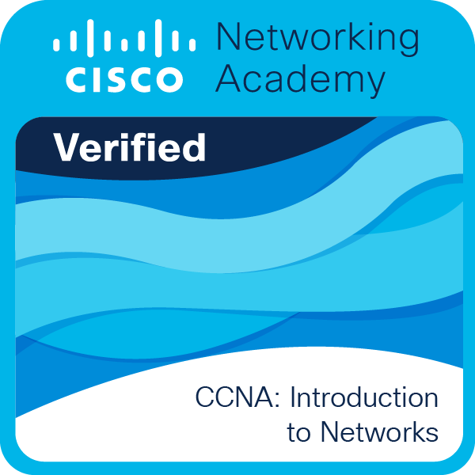
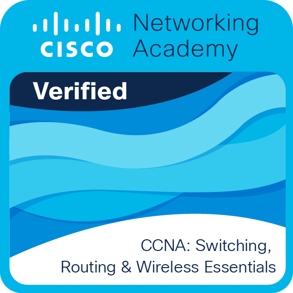
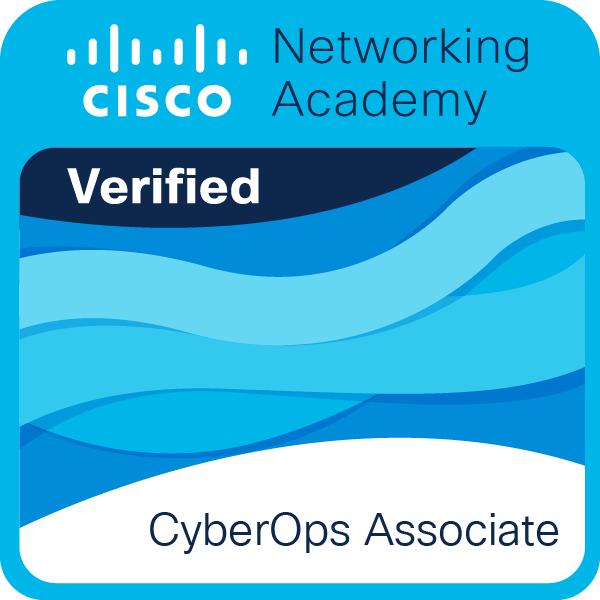
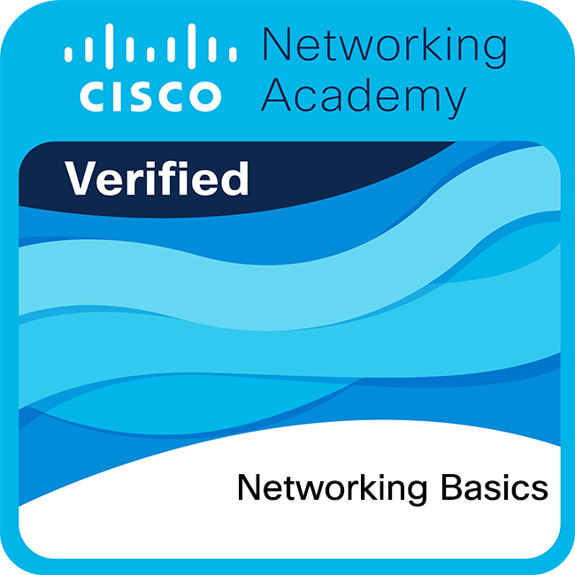
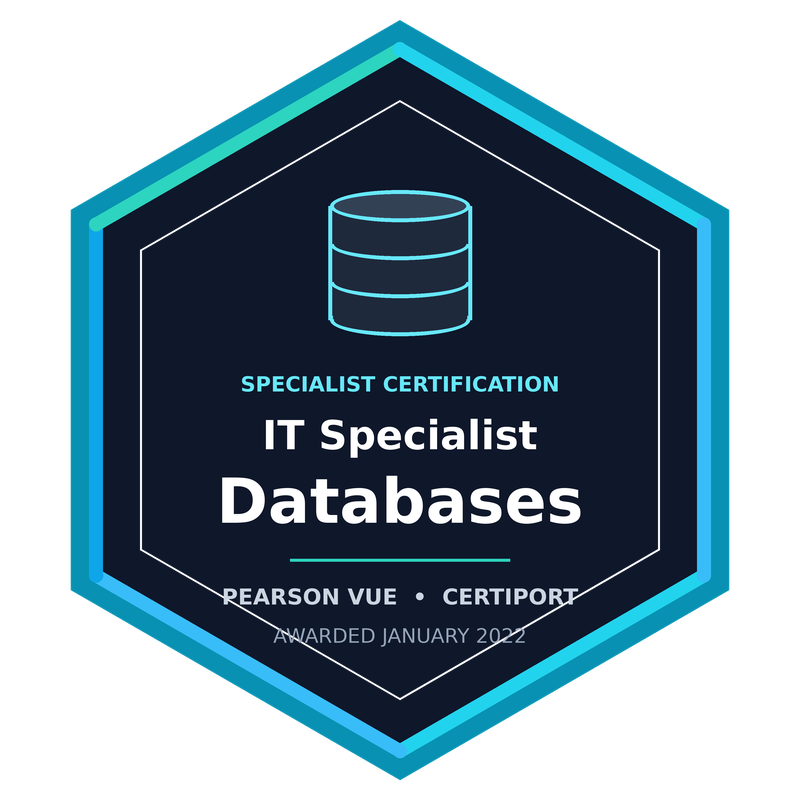
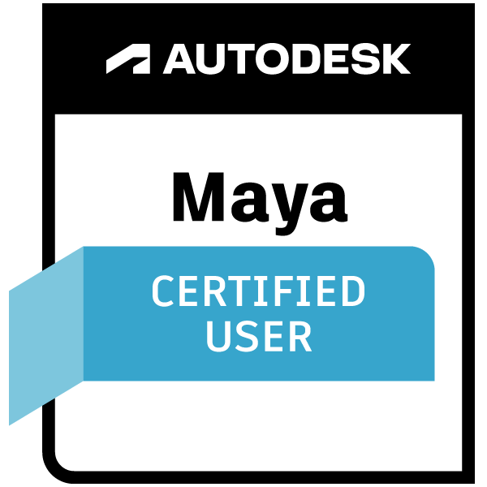

# Hi, I'm Jervil Angelo De Leon 👋

<div align="center">


<br/>


<br/>

[](https://github.com/jervilangelo/de-leon-portfolio)
[](https://www.linkedin.com/in/jervilangelo/)
[](mailto:deleonangelojervil@gmail.com)

<br/>


</div>

---

## About Me

I'm an **HRIS Technical Support professional** based in the Philippines, continuously expanding my knowledge and practical experience in **AWS Cloud Computing, Infrastructure Engineering, and IT Automation**.

Alongside my professional work, I design, build, and deploy projects that solve practical problems while strengthening my understanding of cloud architecture, networking, security, and serverless technologies.

My goal is to grow into a **Cloud / Infrastructure Engineer** through continuous learning, certifications, and hands-on experience.

```yaml
current_role: HRIS Technical Support
career_direction: Cloud & Infrastructure Engineering
focus_areas:
  - AWS Cloud Infrastructure
  - Serverless Applications
  - Cloud Networking & Security
  - Infrastructure Automation
  - Real-World Application Deployment
approach: Learn → Build → Deploy → Improve
```

---

## Featured Project — Teolohiya.site

<div align="center">

### 📚 [Teolohiya.site](https://teolohiya.site)

**A Philippine marketplace for Christian theological books**

[](https://teolohiya.site)
[](https://github.com/jervilangelo/teolohiya-repo)

</div>

Teolohiya.site is a web platform built to help Filipino Christians **discover, buy, and sell theological books** within the Philippines.

The platform connects readers and independent sellers, making theological literature easier to discover and more accessible to local communities.

**Technology Stack**

`Next.js` · `TypeScript` · `Tailwind CSS` · `AWS Amplify` · `Amazon Cognito` · `Amazon DynamoDB` · `Amazon S3`

**Project Highlights**

- Developed and launched a publicly accessible web application.
- Built a book-focused discovery and listing experience.
- Designed for the Philippine Christian community.
- Integrated AWS cloud technologies into a practical project.
- Created a platform where buyers and sellers can connect independently.

> A personal project combining my interest in theology with hands-on cloud application development.

---

## Cloud & Technical Projects

<table>
<tr>
<td width="50%" valign="top">

### ☁️ AWS Serverless Ticketing API

`AWS Lambda` `API Gateway` `DynamoDB` `SNS` `CloudWatch`

A serverless HRIS support ticketing application designed to manage requests, track ticket statuses, and automate critical-priority notifications.

**Key areas:** REST APIs, serverless computing, IAM permissions, logging, and monitoring.

[View Repository](https://github.com/jervilangelo/aws-serverless-ticketing-api)

</td>
<td width="50%" valign="top">

### 🔐 Secure EC2 Web Server

`EC2` `VPC` `Linux` `Nginx` `IAM`

Deployed a Linux-based web server inside a custom AWS VPC with configured networking, security groups, and infrastructure security controls.

**Key areas:** Cloud networking, server administration, access control, and deployment.

[View Repository](https://github.com/jervilangelo/secure-ec2-web-server)

</td>
</tr>
<tr>
<td width="50%" valign="top">

### ⚙️ HRIS Template Tracker Automation

`Power Automate` `Excel` `Power BI`

An automation solution for monitoring HRIS template completion across business units, reducing repetitive manual tracking and improving visibility.

**Key areas:** Business process automation, reporting, and workflow improvement.

[View Repository](https://github.com/jervilangelo/hris-template-tracker-automation-)

</td>
<td width="50%" valign="top">

### 🌐 ECCM Church Website

`HTML` `CSS` `JavaScript` `GitHub Pages`

Designed and deployed a responsive website for Evangelical Covenant Church Manila, providing information about worship services, ministries, and church life.

**Key areas:** Web development, DNS configuration, custom domains, and deployment.

[View Repository](https://github.com/jervilangelo/eccm-web) · [Live Website](https://ecc-manila.org)

</td>
</tr>
</table>

### 💻 Personal Portfolio

`HTML` · `CSS` · `JavaScript`

My personal portfolio showcasing technical projects, certifications, practical experience, and my ongoing development in cloud computing.

[View Repository](https://github.com/jervilangelo/de-leon-portfolio)

---

## Certifications

<div align="center">

### Amazon Web Services


**AWS Certified Cloud Practitioner** · **AWS Certified AI Practitioner**

### Oracle Cloud Infrastructure


**OCI Foundations Associate** · **OCI AI Foundations Associate**

### Networking & Cybersecurity






### IT Support & Other Credentials





</div>

---

## Technical Skills

<div align="center">

**Cloud Platforms**


**AWS Infrastructure & Services**


**Development & Infrastructure**


**Automation & Reporting**


</div>

---

## GitHub Activity

<div align="center">


<br/>


</div>

---

<div align="center">

### Building with Purpose. Learning Through Practice.

*Continuously growing in cloud computing, one practical project at a time.*

**[Explore My Projects](https://github.com/jervilangelo?tab=repositories) · [Visit Teolohiya.site](https://teolohiya.site) · [Connect on LinkedIn](https://www.linkedin.com/in/jervilangelo/)**

</div>
