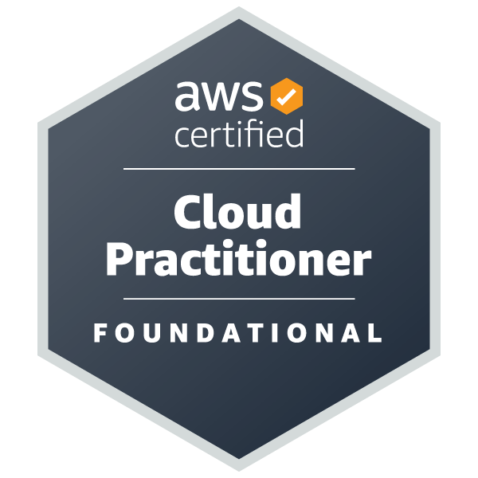
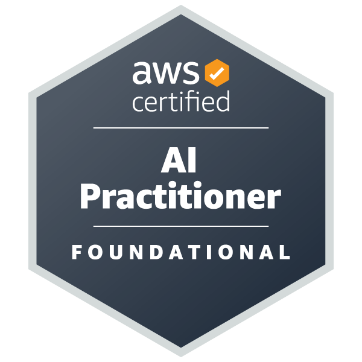
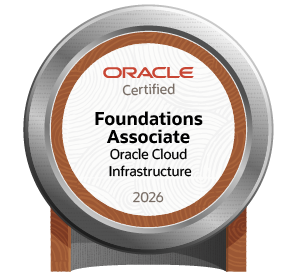
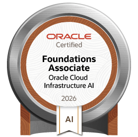

### HRIS Technical Support · 2x AWS Certified & 2x OCI Certified · Cloud & Infrastructure Projects

**Building my way into the cloud.**

Hands-on projects. Documented decisions. Learning through deployment and recovery.

## About me

I'm **Jervil Angelo De Leon**, a Philippines-based HRIS Technical Support professional building practical experience in **cloud infrastructure, serverless applications, security, and automation**. I turn real support scenarios and community needs into projects I can deploy, test, and improve.

I'm working toward a **Cloud / Infrastructure Engineering** role, with a focus on **AWS, Terraform, CI/CD, Linux, and reliable operations**.

## Latest projects

### BayanihanDR · Terraform-powered disaster recovery

A disaster recovery proof of concept for Philippine small businesses. It verifies database backups, stores encrypted copies off-site, and uses **Terraform** to provision a temporary AWS recovery environment after operator approval.

- **Infrastructure as code:** Terraform manages standby resources and temporary recovery servers in AWS Singapore.
- **CI/CD:** GitHub Actions checks application code, backup integrity, Terraform, and the dashboard, and deploys the public demo.
- **Measured recovery:** a real AWS drill recovered the sample application in **5 min 29 sec**, with **26 sec of potential data loss**. These are single-run results on synthetic data; off-site uploads currently require an operator session.

**AWS:** EC2 · S3 · IAM · IAM Identity Center · Systems Manager · CloudWatch · AWS Budgets

**Tools:** Terraform · Python · FastAPI · PostgreSQL · Docker · React · GitHub Actions

[**Explore the demo →**](https://jervilangelo.github.io/bayanihan-dr/) · [Source code](https://github.com/jervilangelo/bayanihan-dr) · [Recovery drill evidence](https://github.com/jervilangelo/bayanihan-dr/blob/main/docs/evidence/phase7-disaster-drill.md)

### Teolohiya.site · A serverless book-listing platform

A live platform that helps Filipino readers discover and list Christian theological books. Sellers submit listings and photos; moderators review them before publication; readers contact sellers directly.

- **Serverless backend:** Amplify Gen 2 provisions authentication, a GraphQL API, storage, and backend functions.
- **Access control:** Cognito roles, scoped IAM permissions, and Lambda-controlled moderation protect listings and administrative actions.
- **Delivery:** GitHub-connected Amplify deployments serve the Next.js application over HTTPS.

**AWS:** Amplify · Cognito · AppSync · DynamoDB · S3 · Lambda · CloudFront · ACM · IAM · CDK / CloudFormation

**Tools:** Next.js · TypeScript · Tailwind CSS

[**Visit Teolohiya.site →**](https://teolohiya.site) · [Source code and architecture](https://github.com/jervilangelo/teolohiya-repo)

### PinansyalPH · Philippine money calculators

A financial education project, currently presented as **Worth It Ba Sa Pilipinas?**, that helps Filipinos explore salary deductions, expenses, MP2 savings, digital bank returns, and the effect of inflation on purchasing power.

- **Useful calculations:** compare savings in pesos and inflation-adjusted value, and estimate take-home pay and expenses.
- **Data updates:** scheduled GitHub Actions retrieve and validate economic data, keeping the last valid dataset if a source fails.
- **CI/CD:** data validation, lint, unit tests, browser tests, and a production build run before GitHub Pages deployment.

**Tools:** React · TypeScript · Vite · Tailwind CSS · Recharts · Vitest · Playwright · GitHub Actions · GitHub Pages

[**Try the calculators →**](https://jervilangelo.github.io/pinansyalph/) · [Source code and methodology](https://github.com/jervilangelo/pinansyalph)

## AWS services I've used

| Area | Services | Where I applied them |
|---|---|---|
| Compute and networking | **EC2, VPC, Systems Manager** | Recovery infrastructure and a hardened Linux/Nginx web server |
| Serverless APIs | **Lambda, API Gateway, AppSync** | HRIS ticketing API and Teolohiya's listing and moderation workflows |
| Data and storage | **S3, DynamoDB** | Verified off-site backups, book photos, listings, and support tickets |
| Identity and access | **IAM, IAM Identity Center, Cognito** | Scoped permissions, temporary operator access, and application roles |
| Hosting and delivery | **Amplify, CloudFront, ACM** | Teolohiya hosting, content delivery, and managed HTTPS |
| Monitoring and cost | **CloudWatch, SNS, AWS Budgets** | Recovery logs, ticket alerts, monitoring, and budget notifications |
| Infrastructure as code | **Terraform, CDK / CloudFormation** | Reproducible recovery infrastructure and Amplify Gen 2 backend resources |

Amplify manages several of Teolohiya's underlying AWS resources. The service list reflects their roles in the deployed application.

## More projects

| Project | What I built |
|---|---|
| [AWS Serverless Ticketing API](https://github.com/jervilangelo/aws-serverless-ticketing-api) | An HRIS support API with ticket tracking, critical-ticket notifications, and monitoring using Lambda, API Gateway, DynamoDB, SNS, and CloudWatch. |
| [Secure EC2 Web Server](https://github.com/jervilangelo/secure-ec2-web-server) | A Linux/Nginx server in a custom VPC with security groups, IAM, and EBS snapshots. |
| [HRIS Template Tracker Automation](https://github.com/jervilangelo/hris-template-tracker-automation-) | Completion tracking across business units using Power Automate, Excel, and Power BI. |
| [ECCM Church Website](https://github.com/jervilangelo/eccm-web) | A responsive nonprofit website with a custom domain, visitor resources, and SEO essentials. |

## Certifications

**2x AWS Certified**

 

**2x Oracle Cloud Infrastructure Certified**

 

[Explore my certifications and learning journey →](https://jervilangelo.github.io/de-leon-portfolio/certifications)

Additional training includes Cisco networking and cybersecurity, Google IT Support and System Administration, and IT Specialist: Databases.

## Tools I build with

## Building in public

**Explore the projects, architecture decisions, and lessons behind the code.**

[LinkedIn](https://www.linkedin.com/in/jervilangelo/) · [Email](mailto:deleonangelojervil@gmail.com) · [All repositories](https://github.com/jervilangelo?tab=repositories)

