<div align="center">


<a href="https://readme-typing-svg.demolab.com/">
  
</a>

<br><br>

<a href="https://github.com/jervilangelo"></a>
<a href="https://www.linkedin.com/in/jervilangelo/"></a>
<a href="mailto:deleonangelojervil@gmail.com"></a>

<br><br>


</div>

---

## 👨‍💻 About Me

I work in HRIS Technical Support and build practical projects in AWS cloud services, server deployment, serverless development, and business process automation. I enjoy solving real-world problems with technology.

```yaml
goal: Cloud / Infrastructure Engineer
currently_learning: [Cloud Networking, Security, Infrastructure Automation]
```

---

## 📊 Dashboard

<div align="center">


<br><br>


<picture>
  <source media="(prefers-color-scheme: dark)" srcset="https://raw.githubusercontent.com/jervilangelo/jervilangelo/output/github-snake-dark.svg" />
  <source media="(prefers-color-scheme: light)" srcset="https://raw.githubusercontent.com/jervilangelo/jervilangelo/output/github-snake.svg" />
  
</picture>

</div>

---

## 🏅 Certifications & Badges

<div align="center">

### ☁️ Amazon Web Services

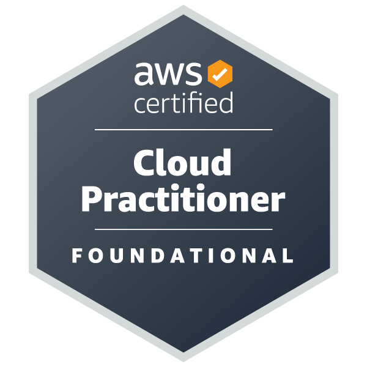
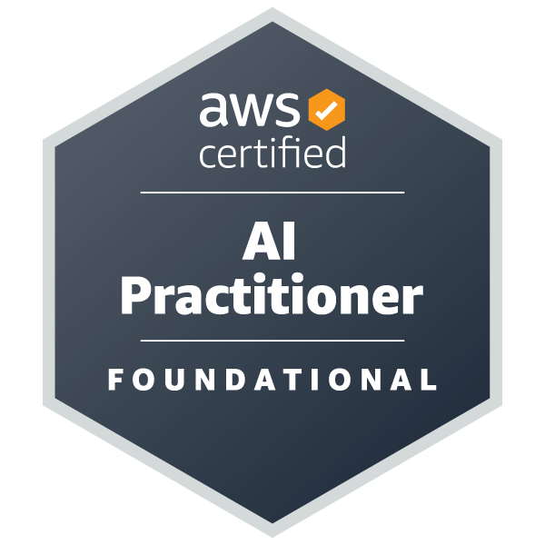

### 🔴 Oracle Cloud Infrastructure


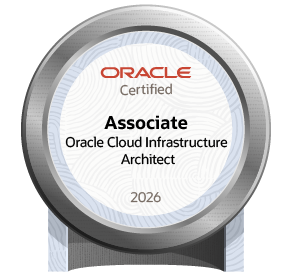
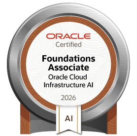
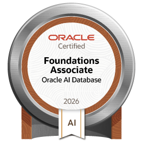
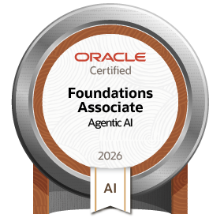

### 🌐 Networking & Security (Cisco)

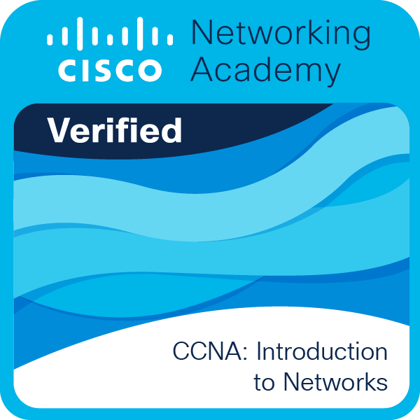
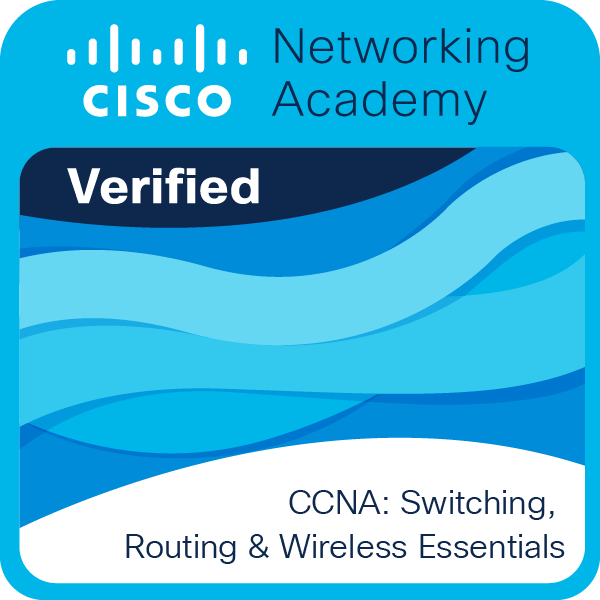
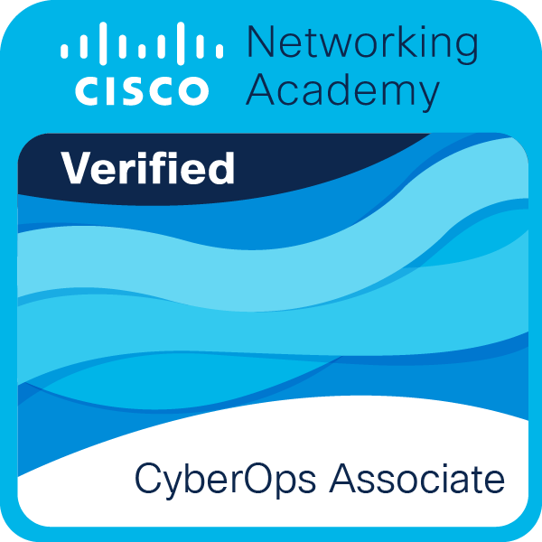
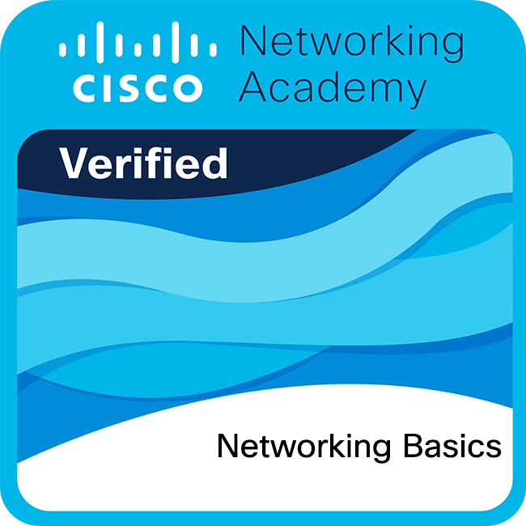

### 🛠️ IT Support, Systems & Databases


### 🎨 Creative

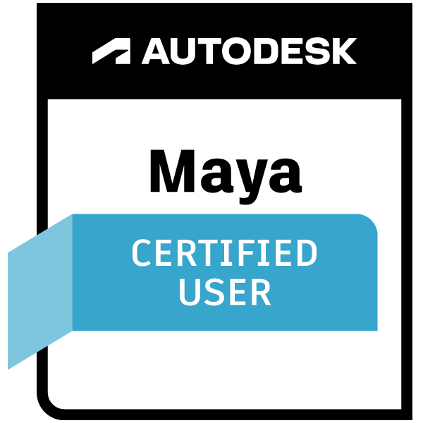

</div>

---

## 🚀 Featured Projects

<table>
<tr>
<td width="50%" valign="top">

### 01. AWS Serverless Ticketing API
`Lambda` · `API Gateway` · `DynamoDB` · `SNS` · `CloudWatch`

A serverless HRIS ticketing API that manages support requests, tracks SLAs, and sends email alerts for critical tickets, with CloudWatch logging and monitoring.

[**Explore Repository →**](https://github.com/jervilangelo/aws-serverless-ticketing-api)

</td>
<td width="50%" valign="top">

### 02. Secure EC2 Web Server
`EC2` · `Custom VPC` · `Nginx` · `HTML`

A web server deployed on AWS EC2 inside a custom VPC, focused on cloud networking, server deployment, and security configuration.

[**Explore Repository →**](https://github.com/jervilangelo/secure-ec2-web-server)

</td>
</tr>
<tr>
<td width="50%" valign="top">

### 03. HRIS Template Tracker Automation
`Power Automate` · `Excel` · `Power BI`

Tracks HR template completion across business units, replacing manual file checks with a daily-synced dashboard.

[**Explore Repository →**](https://github.com/jervilangelo/hris-template-tracker-automation-)

</td>
<td width="50%" valign="top">

### 04. Portfolio
`HTML` · `CSS`

A personal portfolio website presenting my background, technical projects, and development journey.

[**Explore Repository →**](https://github.com/jervilangelo/de-leon-portfolio)

<br>

### 05. ECCM Church Website
`HTML` · `CSS` · `GitHub Pages`

A mobile-friendly, multi-page website for Evangelical Covenant Church Manila, with ministries, what-to-expect, and contact pages.

[**Explore Repository →**](https://github.com/jervilangelo/eccm-web) · [**Live Site →**](https://jervilangelo.github.io/eccm-web/index.html)

</td>
</tr>
</table>

---

## 🧰 Technical Skills

<div align="center">

**Cloud Platforms**


**AWS Services**


**Networking & Servers**


**Automation & Development**


</div>

---

<div align="center">

*Building, learning, and improving one project at a time.*

</div>
